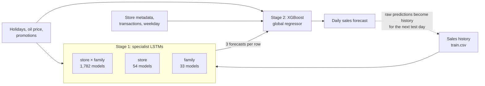

# Hierarchical LSTM + XGBoost Sales Forecasting

A two-stage forecasting pipeline for Kaggle's [Store Sales – Time Series Forecasting](https://www.kaggle.com/competitions/store-sales-time-series-forecasting) competition. It forecasts 16 days of daily unit sales for every (store, product family) pair across 54 Corporación Favorita stores in Ecuador.

**Approach:** 1,869 small "specialist" LSTMs forecast sales at three levels of aggregation. Their forecasts become features for a single global XGBoost model, which also sees holiday, oil price, promotion, weekday and store metadata. Test-time inference runs recursively, one day at a time, feeding each day's predictions back in as history for the next.

## Architecture



### Stage 1: specialist LSTMs

The series are grouped three ways, giving the global model views of the same signal at different granularities:

| Level | Groups | Series |
|---|---|---|
| Store × family | 54 × 33 | Raw sales for that pair |
| Store | 54 | Mean daily sales across the store's families |
| Family | 33 | Mean daily sales for that family across all stores |

Each series is scaled by its own maximum, then turned into sliding windows of 20 days with 7 features per step:

- sales, day-on-day rate of change, 5-day rolling mean and standard deviation
- holiday/event flag, matched to the store's city and state (any non-transferred entry in `holidays_events.csv`)
- promotions (a count per pair; the mean across the group at store and family level), WTI oil price

Every specialist has the same small architecture: `Normalization → LSTM(64, dropout 0.2) → Dense(1)`, trained with Adam on MSE for 50 epochs. The last 25% of each series is held out and used only to report validation RMSE. The specialists' predictions over the training period are cached to `predictions/` as JSON, and the models themselves to `my_models/`.

### Stage 2: XGBoost

A single `XGBRegressor` (800 trees, loss-guided growth, up to 256 leaves, native categorical support) is trained on every row of the training set with:

- the three LSTM forecasts
- store metadata: number, city, state, cluster, type (D, C or other)
- product family, weekday, holiday flag, promotions, oil price, store transactions

### Recursive inference

The test period has no sales history. For each of the 16 test days in order, the pipeline:

1. takes the last 21 days of every series, including days already predicted
2. runs all 1,869 specialists on the first 20 of those days
3. runs XGBoost on that day's rows, with the specialist outputs as features
4. appends the raw (unclipped) predictions to the history before moving to the next day

Negative forecasts are clipped to zero only when the submission is written.

### Experiment: single LSTM with embeddings

The end of the notebook trials a single global model as an alternative to the specialists. It has learned embeddings for store and family (8-d each), concatenated with the same sequence features and fed through three stacked LSTM(64) layers. Early stopping halted it after 4 epochs, with validation RMSE rising every epoch (0.188 → 0.207 on scaled sales). It was not used for a submission.

## Results

Metric: Root Mean Squared Logarithmic Error (RMSLE), where lower is better.

| Kaggle submission | Public leaderboard RMSLE |
|---|---|
| Best | **0.90875** |
| Earlier submissions | 1.66526, 2.10891 |

The `0.6933` printed in the notebook is measured on the training data (the validation split is overwritten by the full set before fitting), so it is not an estimate of out-of-sample error.

## Known limitations

These are documented rather than fixed, and are likely contributors to the gap between the leaderboard score and the model's complexity.

- **One-day lag at test time.** In training, each row's LSTM feature is the forecast *for that day*. At inference, the 21-day slice yields one window ending a day earlier, so the feature for test day *d* is the specialists' estimate of day *d − 1*.
- **No true hold-out evaluation.** XGBoost is fit and scored on the full training set.
- **Train/test mismatch in the LSTM features.** About 75% of training rows carry in-sample fits; test rows carry genuine forecasts.
- **`transactions` is 0 for every test row.** The transactions data ends before the test period, and the lookup falls back to a default of 0.
- **Slow inference.** Each specialist is reloaded from disk for every test day.

## Running it

**Reproducing the submission from a fresh clone isn't currently possible.** The trained models and cached predictions aren't in the repo, and regenerating them needs fixes:

- `train_specialists` hasn't been updated for `process_lstm_data`'s `(dfs, scale_factors)` return value.
- Only the store × family specialists have a training call; the store and family levels don't.
- The family `BREAD/BAKERY` turns its model path into a nested directory.
- The models are saved without a file extension (Keras 2 SavedModel). Keras 3, which TensorFlow 2.16+ uses by default, won't save or load them. Install `tf-keras` and set `TF_USE_LEGACY_KERAS=1` before importing TensorFlow.

To explore the code and data:

```bash
pip install -r requirements.txt jupyter kaggle
kaggle competitions download -c store-sales-time-series-forecasting   # needs a Kaggle API token and the competition rules accepted
unzip store-sales-time-series-forecasting.zip -d data/
mkdir my_models predictions
```

`requirements.txt` pins the package versions installed when the notebook was last opened (Python 3.13).
